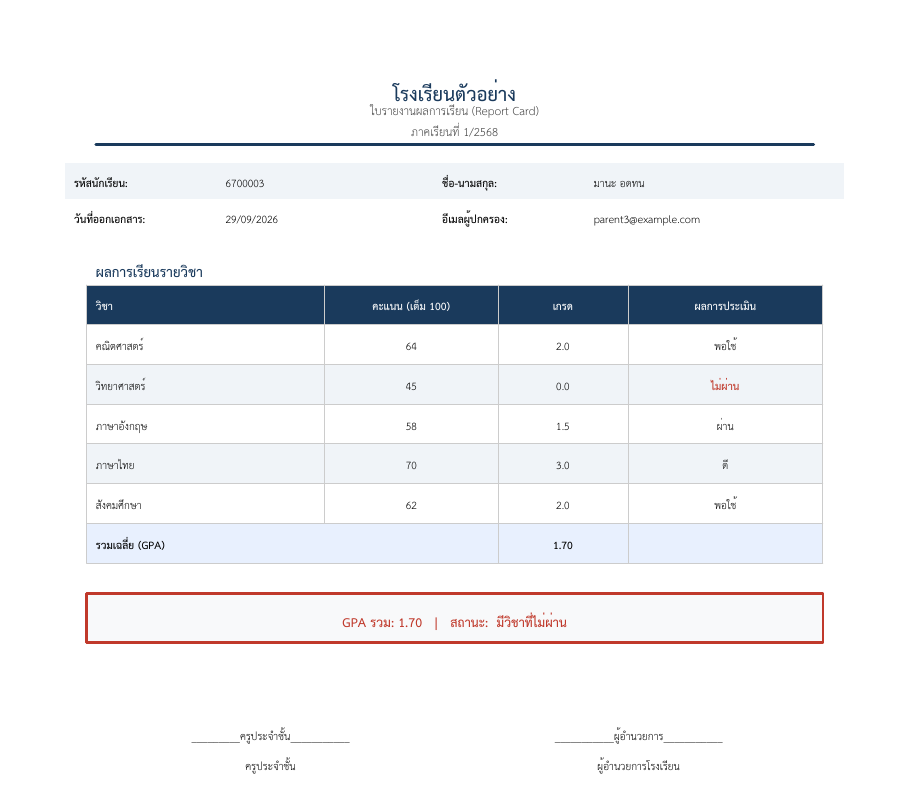

# 🤖 Report Card RPA Bot

An RPA (Robotic Process Automation) bot that automatically generates student report cards as Thai-language PDFs and emails them to parents.

บอท RPA ที่สร้างใบรายงานผลการเรียนเป็นไฟล์ PDF ภาษาไทย และส่งอีเมลถึงผู้ปกครองโดยอัตโนมัติ — โปรเจกต์วิชา Robotic Process Automation



## ✨ Features

- **Read data** — loads student scores from a CSV file
- **Validate** — checks for missing fields, out-of-range scores (0–100) and invalid email addresses; bad rows are skipped and logged instead of crashing the run
- **Grade** — converts scores to the Thai 8-level grade scale (0.0–4.0) and calculates GPA
- **Generate PDF** — builds a formatted A4 report card with Thai font (TH Sarabun New), failing subjects highlighted in red
- **Email** — sends each PDF to the parent via SMTP (Gmail)
- **Log & summarize** — writes a run log (`bot_log.log`) and a per-student result file (`summary.csv`)

## 🔄 Workflow

```
students.csv → Validate → Calculate grades & GPA → Generate PDF → Send email → summary.csv + log
```

## 🛠️ Tech Stack

Python · pandas · ReportLab · smtplib · python-dotenv

## 🚀 Getting Started

**1. Install dependencies**
```bash
pip install -r requirements.txt
```

**2. Configure email (optional)**

Copy `.env.example` to `.env` and fill in your details. For Gmail, use an [App Password](https://support.google.com/accounts/answer/185833), not your normal password.
```
EMAIL_SENDER=your_email@gmail.com
EMAIL_PASSWORD=your_gmail_app_password
SEND_EMAIL=true
```
With `SEND_EMAIL=false` (default), the bot only generates PDFs — useful for testing.

**3. Run**
```bash
python rpa_bot.py
```
PDFs are saved in `report_cards/`, and results in `summary.csv`.

## 📊 Sample Data & Output

`students.csv` contains fictional sample data, including two intentionally invalid rows to demonstrate validation:

| student_id | name | GPA | status | reason |
|---|---|---|---|---|
| 6700001 | สมชาย ใจดี | 3.70 | ✅ success | |
| 6700002 | สมหญิง รักเรียน | 4.00 | ✅ success | |
| 6700003 | มานะ อดทน | 1.70 | ✅ success | |
| 6700004 | ปิติ ยิ้มแย้ม | – | ❌ error | missing English score |
| 6700005 | ชูใจ สดใส | – | ❌ error | invalid email format |

A full sample PDF is in [`docs/sample_report_card.pdf`](docs/sample_report_card.pdf).

## 📁 Project Structure

```
├── rpa_bot.py          # main bot script
├── students.csv        # input data (sample)
├── requirements.txt
├── .env.example        # email config template
├── fonts/              # TH Sarabun New (Thai font)
└── docs/               # sample output
```

## ⚙️ Customization

Edit `CONFIG` and `SUBJECTS` at the top of `rpa_bot.py` to change the school name, semester, passing score or subject list.

## 👥 Authors

- พีรพล อินทะสิทธิ์ (Phirapon Intasit)
- พีรณัฐ เมฆฉาย

## 📝 Credits

TH Sarabun New font by SIPA (Software Industry Promotion Agency), free to use and redistribute.
